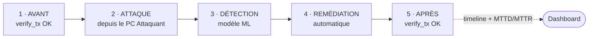
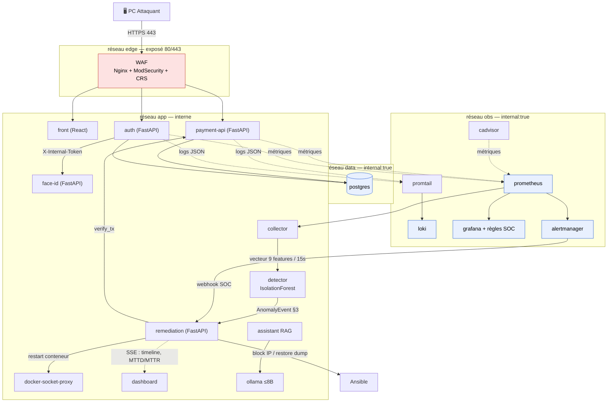
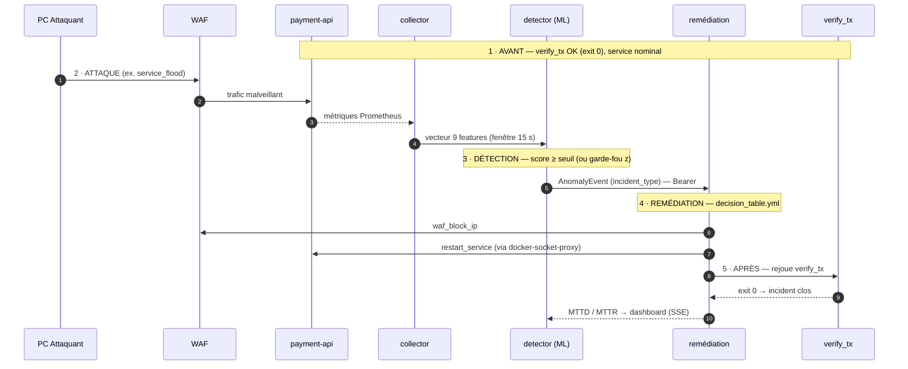

# Guide développeur — PROJECT RESILIENCE-ALPHA (Workshop2026-M2-G1)

> **But de ce document :** permettre à un·e nouveau·elle développeur·euse de comprendre *l'intégralité* du projet — vision, architecture, chaque composant, comment le lancer, le tester, le modifier — avec ce seul fichier comme point d'entrée. Les documents de référence figés (contrats, architecture, ADR, gouvernance) sont cités et liés ; ce guide les rassemble et les explique, il ne les remplace pas.
>
> Dernière synthèse : 2026-10-22. En cas de divergence entre ce guide et un document **figé** (`docs/contracts.md`, ADR), c'est le document figé qui fait foi — et il faut corriger ce guide.

## Table des matières

1. [Le projet en 3 minutes](#1-le-projet-en-3-minutes)
2. [Vocabulaire et concepts clés](#2-vocabulaire-et-concepts-clés)
3. [Architecture d'ensemble](#3-architecture-densemble)
4. [La boucle Zero-Touch Recovery (chemin critique)](#4-la-boucle-zero-touch-recovery-chemin-critique)
5. [Les contrats d'interfaces (le cœur de l'intégration)](#5-les-contrats-dinterfaces-le-cœur-de-lintégration)
6. [Démarrage rapide — environnement de dev](#6-démarrage-rapide--environnement-de-dev)
7. [Catalogue des composants](#7-catalogue-des-composants)
8. [Le modèle de données](#8-le-modèle-de-données)
9. [Sécurité — les points durs](#9-sécurité--les-points-durs)
10. [Workflow de contribution (Definition of Done)](#10-workflow-de-contribution-definition-of-done)
11. [Référence des commandes `make`](#11-référence-des-commandes-make)
12. [Carte de la documentation du dépôt](#12-carte-de-la-documentation-du-dépôt)
13. [Pièges connus et FAQ](#13-pièges-connus-et-faq)

---

## 1. Le projet en 3 minutes

**RESILIENCE-ALPHA** est un démonstrateur de **cyber-résilience et de reprise autonome** (*Zero-Touch Recovery*, ZTR), réalisé pour le Workshop national EPSI M2 2026-27 par le consortium **G1**.

Le scénario : une **plateforme de paiement fictive** conteneurisée (« Banque Résilience ») subit une attaque lancée **depuis un PC distinct**. Un **modèle de machine learning** détecte l'anomalie, un **moteur de remédiation** décide et exécute automatiquement la correction, et une **transaction de vérification** réussie prouve le retour à la normale — **sans aucune intervention humaine**.

Le critère de réussite unique est **la démo en 5 temps**, jouable d'une commande et filmable en ≤ 60 s sans coupure :



avec une **timeline et les métriques MTTD/MTTR** affichées sur le dashboard. Tout le reste du projet sert ce critère.

> ⚠️ **Toutes les données sont fictives** (comptes, transactions, utilisateurs). Aucune donnée bancaire réelle. Le périmètre offensif est strictement limité au SI du projet (réseau `RESILIENCE-G1`). C'est un travail de sécurité **défensive / Blue Team** à visée pédagogique.

Le sujet s'articule en **5 piliers** interconnectés, tous obligatoires :

| Pilier | Ce qu'il couvre | Où dans le dépôt |
|---|---|---|
| **Développement** | SI de paiement microservices, moteur de remédiation, dashboard | `services/*`, `remediation/`, `dashboard/` |
| **Infrastructure** | Déploiement reproductible, automatisation, observabilité | `infra/*` |
| **IA / Data** | Détection d'anomalies ML (AIOps) + assistant RAG local | `ml/*`, `assistant/` |
| **Cybersécurité** | Red Team, WAF, SOC, durcissement, secrets | `security/*`, `attacks/` |
| **Transformation** | Analyse de risques, PCA/PRA, conformité | `docs/ebios-rm.md`, `docs/pca-pra.md`, `docs/nis2-dora.md` |

**Document maître de traçabilité** (chaque exigence R1–R20 du sujet → composant qui la réalise) : [`CAHIER-DES-CHARGES.md`](../CAHIER-DES-CHARGES.md). **Suivi d'avancement** : [`ROADMAP.md`](../ROADMAP.md).

---

## 2. Vocabulaire et concepts clés

| Terme | Signification dans ce projet |
|---|---|
| **ZTR / Zero-Touch Recovery** | La reprise automatique sans intervention humaine. La boucle détection → décision → action → vérification. |
| **MTTD** | *Mean Time To Detect* — délai entre le début de l'incident et la première action corrective. Métrique `resilience_mttd_seconds`. |
| **MTTR** | *Mean Time To Recover* — délai jusqu'au retour prouvé à la normale (`verify_tx` OK). Métrique `resilience_mttr_seconds`. |
| **AnomalyEvent** | L'objet JSON (contrat §3) émis par le detector vers le moteur de remédiation quand une anomalie est détectée. |
| **incident_type** | Énumération figée qui fait le pont détection → action : `service_flood`, `auth_abuse`, `web_attack`, `data_corruption`, `unknown`. |
| **Table de décision** | `remediation/decision_table.yml` — mappe chaque `incident_type` vers une séquence d'actions. Source de vérité, pas de `if` codé en dur. |
| **verify_tx** | Le script `scripts/verify_tx` qui rejoue une transaction de bout en bout à travers le WAF. **Exit 0 = service utilisable.** C'est la preuve de reprise. |
| **Feature vector** | Le vecteur de 9 features (fenêtre 15 s) consommé par le ML. Défini **une seule fois** dans `ml/shared/features.py`. |
| **Fonction SOC** | Le « SIEM léger » assuré par les règles d'alerte Loki/Grafana (ADR 0003), pas un vrai SIEM. |
| **docker-socket-proxy** | Le proxy HAProxy à liste blanche stricte par lequel — et uniquement par lequel — le moteur touche Docker (ADR 0002). |
| **PC Hôte / PC Attaquant / PC IA** | Les 3 postes de la démo (voir §3). L'attaque vient toujours d'un vrai 2e PC pour la démo notée. |
| **Consigne Additionnelle 1** | Durcissement de l'accès back-office : login à étapes (identifiant → **visage** → mot de passe) + témoin **LED IoT**. N'impacte **jamais** la boucle ZTR. |
| **DoD** | *Definition of Done* — le flow non négociable : code → tests verts → doc → roadmap (voir §10). |

---

## 3. Architecture d'ensemble

### 3.1 Les trois postes (matériel & réseau)

| Poste | Rôle | Spécifications |
|---|---|---|
| **PC Hôte** | Exécute toute la stack Docker ; délivre le point d'accès WiFi `RESILIENCE-G1` (IP `192.168.137.1`). La caméra USB du facteur visage y est branchée. | Windows 10/11, Docker Desktop + WSL2, ≥ 4 cœurs, ≥ 16 Go RAM, ≥ 50 Go SSD |
| **PC Attaquant** | Lance les scénarios offensifs vers le WAF du PC Hôte (démo notée + Clip Chrono). | ≥ 8 Go RAM |
| **PC IA** *(optionnel)* | Héberge uniquement Ollama + l'assistant RAG si la RAM du PC Hôte est serrée. | — |

Détail réseau et pare-feu : [`docs/network.md`](network.md).

### 3.2 Réseaux Docker (cloisonnement)

Définis dans `infra/compose/docker-compose.yml`. **Il n'y a que 4 réseaux** (l'assistant et Ollama vivent sur `app`, il n'y a pas de réseau `ai` séparé) :

| Réseau | Propriété | Contenu | Exposition |
|---|---|---|---|
| `edge` | exposé | `waf`, `attacker` (dev) | **Seul réseau avec des ports HTTP publiés (80/443)** |
| `app` | sortie Internet autorisée (pull images/modèles) | front, payment-api, auth, detector, collector, remediation, docker-socket-proxy, dashboard, prometheus, mosquitto, ollama, assistant | Aucun `ports:` (sauf Mosquitto en profil `iot`) |
| `data` | `internal: true` | postgres, pg-exporter | Jamais exposé |
| `obs` | `internal: true` | prometheus, loki, promtail, grafana, alertmanager, cadvisor, waf-exporter | Jamais exposé, pas de sortie Internet |

**Règle d'or :** seul le **WAF** publie des ports HTTP (80/443) ; seul **Mosquitto** publie du MQTT (1883, sur l'IP du PA, et seulement en profil `iot`). Base de données, secrets, API internes et interfaces de management restent sur des réseaux internes.

### 3.3 Vue logique



> **Lecture :** une seule flèche entrante (le PC Attaquant → WAF, en HTTPS). Tout le reste est interne. Le moteur de remédiation n'est jamais sur `edge` et ne touche Docker qu'à travers le `docker-socket-proxy`.

Schéma et flux détaillés : [`docs/architecture.md`](architecture.md). Décisions structurantes : [`docs/adr/`](adr/).

---

## 4. La boucle Zero-Touch Recovery (chemin critique)

C'est **le** flux à comprendre en priorité.



Les 5 temps en détail :

1. **Avant** — `verify_tx` rejoue une transaction fictive à travers le WAF → **exit 0**. Le service est nominal.
2. **Attaque** — un scénario est lancé depuis le PC Attaquant vers le WAF (ex. `service_flood` : rafale de requêtes).
3. **Détection** — le `collector` agrège les métriques Prometheus toutes les 15 s en un **vecteur de 9 features** ; le `detector` le score avec un **IsolationForest** ; si le score dépasse le seuil (ou le garde-fou z-score), il classe l'`incident_type` et émet un **AnomalyEvent** authentifié vers le moteur.
4. **Remédiation** — le moteur lit `decision_table.yml`, exécute les actions de la règle dans l'ordre (ex. `waf_block_ip` puis `restart_service`), en respectant `cooldown`/`max_attempts`/`dry_run`.
5. **Après** — le moteur rejoue `verify_tx` ; dès qu'il repasse à **exit 0**, l'incident est **clos**, MTTD/MTTR sont calculés, et la timeline est poussée au dashboard via SSE. **Sans intervention humaine.**

**Chemin SOC (secondaire, redondant)** : les règles Prometheus (`infra/prometheus/rules/soc.yml`) déclenchent Alertmanager, qui poste son webhook sur `POST /events/alertmanager` ; un adaptateur le traduit dans le schéma AnomalyEvent. Les deux chemins (ML et SOC) convergent vers le même moteur.

> **Distinction imposée par le sujet :** restaurer la **disponibilité** (`service_flood` → block IP + restart) ≠ corriger une **compromission/corruption** (`data_corruption` → `restore_pg_dump`). Ne jamais mapper l'un sur l'autre. Le moteur **interdit** structurellement `restart`/`recreate` pour `data_corruption`.

---

## 5. Les contrats d'interfaces (le cœur de l'intégration)

**Document figé : [`docs/contracts.md`](contracts.md).** Tout composant qui s'intègre DOIT le respecter sans le réinterpréter. Résumé opérationnel :

### 5.1 Logs JSON structurés (§1)
Tous les services émettent des logs **JSON une ligne** sur `stdout`. Promtail les récupère → Loki. Champs obligatoires : `ts`, `level`, `service`, `event`, `message`, `request_id`. Champs contextuels selon l'événement (`user`, `client_ip`, `http_*`, `duration_ms`, `anomaly_score`, `incident_id`). Les noms d'`event` sont **normalisés et réservés** (ils alimentent les règles SOC et les features ML) — voir la liste dans le contrat. **Jamais de `print`.**
Implémentation : `resilience_common.logging.get_logger(service)`.

### 5.2 Métriques Prometheus (§2)
Préfixe commun `resilience_`. Exposées via `/metrics`. Clés : `resilience_http_requests_total`, `resilience_transactions_total{result}`, `resilience_auth_logins_total{result}`, `resilience_anomaly_score{service}` (score ML temps réel), `resilience_mttd_seconds` / `resilience_mttr_seconds`, etc. Implémentation : `resilience_common.metrics` + `instrument(app, service)`.

### 5.3 Vecteur de features ML (§2)
Ordre **figé**, source de vérité unique `ml/shared/features.py` (importé par collector, training ET detector — jamais dupliqué) :
```
[ req_per_s, p95_latency_ms, ratio_4xx, ratio_5xx,
  auth_failed_per_s, waf_blocked_per_s,
  cpu_pct_max, mem_pct_max, db_errors_per_s ]
```
Fenêtre de 15 s. Changer une définition impose de recapturer la baseline et les attaques.

### 5.4 Schéma d'AnomalyEvent (§3)
Objet JSON émis par le detector → `POST /events` du moteur (authentifié Bearer). Champs : `schema_version`, `event_id`, `ts`, `source`, `service`, `anomaly_score`, `threshold`, `incident_type`, `features_top[]`, `evidence{}`. Modèle Pydantic : `resilience_common.events.AnomalyEvent`.

### 5.5 Table de décision incident → action (§4)
Source de vérité `remediation/decision_table.yml`. Chaque `incident_type` → liste d'actions ordonnées + `verify` + `escalation`. Garde-fous `defaults` : `cooldown_seconds: 60`, `max_attempts: 3`, `dry_run: false`.

### 5.6 Consigne Additionnelle 1 (§5)
APIs du back-office durci : `face-id` (vérification 1:1, stocke l'embedding jamais l'image), login à étapes de `auth` (`identify → face → password`), protocole LED MQTT/HTTP. **La boucle ZTR n'en dépend jamais.**

### 5.7 API client payment-api (§6)
Toutes les routes `/api/v1/*` consommées par le front, avec leurs contrats (codes retour, anti-énumération via 404, montants en centimes, limites de débit WAF). Référence exhaustive dans le contrat.

### 5.8 Conventions transverses
- **JWT** Bearer HS256, clé via SOPS, durée 15 min (`auth` et `payment-api`).
- **API interne du moteur** : Bearer statique `REMEDIATION_TOKEN` (SOPS), jamais sur `edge`. Idem `INTERNAL_TOKEN` pour `auth → /internal/*`.
- **Health** : chaque service expose `GET /health` (liveness) et `GET /ready` (readiness).
- **Erreurs** : corps JSON `{"error":{"code","message","request_id"}}`.
- **Scripts** : exit `0` = succès, `1` = échec.
- **Versionnement** : préfixe `/api/v1`.

---

## 6. Démarrage rapide — environnement de dev

### 6.1 Prérequis
Docker Desktop (WSL2) + Docker Compose v2 (≥ 2.23.1 pour les secrets Compose), Ansible, Git, Python 3.12, `uv` (ou `venv`), Node.js (pour les fronts), Ollama (sur PC Hôte ou PC IA), et `sops` + `age` pour les secrets.

### 6.2 Lancer la stack complète (le plus simple)

```bash
git clone https://github.com/jesuisleyanis/Workshop2026-M2-G1.git
cd Workshop2026-M2-G1

# 1. Secrets : il faut la clé age de l'équipe dans ~/.config/sops/age/keys.txt
#    (SOPS_AGE_KEY_FILE). make up lance make decrypt qui produit .env.
#    En dev sans la clé, un .env de valeurs FACTICES existe déjà pour le login local.

make up          # décrypt + entraîne le modèle ML si absent + profil demo
# make up-full   # + observabilité complète (alertmanager, cadvisor, pg-exporter)
# make up-iot    # + broker MQTT sur 192.168.137.1:1883 (PC Hôte, PA actif)

make seed        # comptes fictifs demo01..demo05 financés (mdp = SEED_PASSWORD)
make verify      # transaction de contrôle : exit 0 attendu
make demo        # joue les 5 temps (SC=service_flood par défaut)
```

> ⚠️ **Piège connu :** `collector` et `detector` sont en **profil `ml`**. `make up` / `make up-full` ne les démarrent **pas**. Le chemin de détection ML n'est donc pas actif tel quel ; il faut activer le profil `ml` explicitement (`docker compose --profile demo --profile ml up -d`). Le chemin SOC (Alertmanager, profil `full`) reste disponible. C'est un point à garder en tête et à corriger si le câblage évolue.

- **Front client** : `https://localhost` (via le WAF). Comptes `demo01`…`demo05`, mot de passe commun `SEED_PASSWORD`.
- Les API internes ne sont pas publiées. En profil `iot`, seul MQTT est exposé sur `192.168.137.1:1883`.

### 6.3 Environnement Python pour les tests (hors Docker)

Les tests Python exigent un interpréteur **3.12** où les dépendances de *tous* les composants et les libs partagées sont installées :

```bash
uv venv --python 3.12 .venv && source .venv/bin/activate
uv pip install -e "libs/python/resilience_common[fastapi,test]" -e "libs/python/resilience_db[test]" \
  -e services/auth -e services/payment-api -e services/face-id \
  -r remediation/requirements-dev.txt -r assistant/requirements-dev.txt
( cd ml && uv pip install -r requirements-dev.txt )

make test                               # tous les tests (python + front)
make test-py PYTHON=.venv/bin/python    # python uniquement
```

> **Pourquoi un process pytest par composant ?** Chaque service déclare ses métriques Prometheus à l'import ; tout importer dans un seul process lève `DuplicateTimeseries`. `make test-py` lance donc un `pytest` par composant, puis les répertoires de tests de contrat, puis Vitest pour les fronts. Chaque composant reste testable seul depuis son dossier (`cd remediation && pytest`).

Les tests front exigent `npm ci` dans `services/front`, `services/backoffice` et `dashboard`.

---

## 7. Catalogue des composants

Pour chaque composant : rôle, stack, lancement, tests, points d'entrée. Chaque composant possède aussi son `README.md` (comment lancer) et son `CAHIER-DES-CHARGES.md` (quoi + pourquoi).

### 7.1 Services métier

#### `services/payment-api` — API de paiement (FastAPI, port 8001)
- **Rôle** : comptes, virements (ledger avec verrous `SELECT FOR UPDATE`), historique, relevés, cartes, bénéficiaires, virements programmés, notifications, plafonds, statistiques.
- **Stack** : Python 3.12, FastAPI 0.146, SQLAlchemy 2.1, Alembic, psycopg 3, PyJWT, Pydantic 2, prometheus-fastapi-instrumentator. + libs `resilience_common` et `resilience_db`.
- **Fichiers clés** (`src/payment_api/`) : `main.py` (`create_app()`, routes, lifespan = migrations + scheduler), `ledger.py` (règles du virement), `security.py` (JWT), modules métier `cards.py`, `beneficiaries.py`, `schedules.py`, `statements.py`, `notifications.py`, `limits.py`, `stats.py`, `status.py`.
- **Routes** : `/api/v1/accounts`, `/transactions`(+`{id}`), `/cards`(+freeze/unfreeze/PATCH), `/beneficiaries`, `/scheduled-transfers`, `/notifications`, `/statements`, `/stats/spending`, `/limits`, `/status` (public). Détail et contrats : `docs/contracts.md §6`.
- **Env notables** : `JWT_SECRET` (identique à auth), `POSTGRES_PASSWORD`, `DATABASE_URL` (sqlite en test), `SCHEDULER_INTERVAL_S=60`, `STEP_UP_THRESHOLD_CENTS=50000`, `STEP_UP_MAX_AGE_S=300`, `STATUS_CACHE_S=2`.
- **Lancer** : `uvicorn payment_api.main:create_app --factory --port 8001`. **Tester** : `pytest services/payment-api` (SQLite mémoire ; test Postgres concurrent optionnel via `TEST_POSTGRES_URL`).
- **Dépendances** : partage la base PostgreSQL et le `JWT_SECRET` avec `auth` (consomme ses JWT, aucun appel réseau direct).

#### `services/auth` — Authentification (FastAPI, port 8002)
- **Rôle** : login/register JWT, rate-limit anti-brute-force (slowapi), ré-authentification *step-up*, et orchestration du **login à étapes** du back-office.
- **Stack** : comme payment-api + slowapi, httpx, limits.
- **Fichiers clés** (`src/auth_service/`) : `main.py` (routes publiques + internes), `backoffice.py` (login à étapes, `HttpFaceVerifier` qui appelle face-id, `LedNotifier`), `security.py` (JWT, `reissue_with_fresh_auth_time`), `ratelimit.py` (`DynamicRateLimit`), `challenge.py` (`ChallengeStore`, `LockoutStore`).
- **Routes** : `/api/v1/register`, `/login`, `/auth/step-up`, `/auth/identify`, `/auth/face`, `/auth/password` (back-office), et **API interne** (hors WAF, `X-Internal-Token`) `/internal/tighten-rate-limit` et `/internal/reset-rate-limit` (pilotées par le moteur de remédiation).
- **Env notables** : `JWT_SECRET` (partagé), `INTERNAL_TOKEN` (≥16 car.), `LOGIN_RATE_LIMIT=10/minute`, `FACE_ID_URL`, `FACE_INTERNAL_TOKEN`, `BACKOFFICE_FACE_REQUIRED`, variables challenge/lockout.
- **Lancer** : `uvicorn auth_service.main:create_app --factory --port 8002`. **Tester** : `pytest services/auth`.
- **Dépendances** : appelle **face-id** `/api/v1/verify` ; partage base + `JWT_SECRET` avec payment-api ; consommé par **front** et **backoffice**.

#### `services/face-id` — Reconnaissance faciale 1:1 (FastAPI, port 8006)
- **Rôle** : vérifier qu'un visage correspond à un identifiant (1:1) + enrôlement. **RGPD : stocke uniquement l'embedding (vecteur), jamais l'image.** Ne délivre aucun jeton.
- **Stack** : FastAPI, SQLAlchemy, psycopg. Backend ML réel optionnel (insightface + onnxruntime, commenté) ; **backend par défaut = `stub` déterministe** (aucun modèle requis).
- **Fichiers clés** (`src/face_id/`) : `main.py` (routes, `require_internal_token`), `recognizer.py` (interface `Recognizer` : `embed`/`model_version`/`threshold`, `cosine_similarity`, `build_recognizer`), `store.py` (`EnrollmentStore`), `backends/` (`insightface_backend.py`, `team_backend.py` gabarit, stub). Contrat d'intégration d'un modèle d'équipe : `services/face-id/INTEGRATION-ML.md`.
- **Routes** (toutes `X-Internal-Token` sauf sondes) : `POST /api/v1/verify` → `{match, model_version}` (**le score n'est jamais renvoyé** — anti hill-climbing), `POST /api/v1/enroll`, `DELETE /api/v1/enroll/{username}`, `GET /api/v1/enrollments` (aucune donnée biométrique).
- **Env** : `FACE_INTERNAL_TOKEN` (≥16 car.), `RECOGNIZER_BACKEND=stub|insightface|team`, `FACE_MATCH_THRESHOLD`, `POSTGRES_PASSWORD`.
- **Lancer** : `uvicorn face_id.main:create_app --factory --port 8006`. **Tester** : `pytest services/face-id/tests` (déterministe via `StubRecognizer`).
- **Dépendances** : appelé par **auth** uniquement. Table `face_enrollments`.

#### `services/front` — SPA client « Banque Résilience » (React/Vite/TS, port dev 5173)
- **Rôle** : interface utilisateur de la banque : connexion, solde, virements (desktop + assistant mobile), historique, relevés, cartes, bénéficiaires, plafonds, programmés, notifications, statistiques, RIB.
- **Stack** : React 19, react-router 7, Vite 8, TypeScript, Tailwind 4, Vitest.
- **Fichiers clés** (`src/`) : `App.tsx` (routes), `api/index.ts` (tous les endpoints `/api/v1` typés), `api/client.ts` (Bearer, timeout, erreurs, signal de disponibilité), `components/` (`Layout`, `ProtectedRoute`, `AuthProvider`, `BankDataProvider`, `StepUpDialog` pour la ré-auth, `CategoryPicker`, `LimitBar`…), `hooks/` (useAuth, useBankData, useAccounts…), 17 `pages/`, `lib/` (logique métier), `types/api.ts`.
- **Scripts npm** : `dev` (5173), `build` (`tsc --noEmit && vite build` → `dist/`), `preview`, `lint`, `typecheck`, `test` (`vitest run`).
- **Env** : `VITE_API_BASE` (figé au build, vide = same-origin), `DEV_API_TARGET` (défaut `https://localhost` = WAF local), `DEV_AUTH_TARGET`. Le dev proxifie `/api/*` vers auth (login/register/auth) et payment-api (métier). L'UI raisonne en euros/IBAN et convertit en centimes/ids.
- **Dépendances** : consomme payment-api + auth via le WAF. Docker : nginx statique, port 8080, `/healthz`.

#### `services/backoffice` — SPA opérateur durcie (React/Vite/TS, port dev 5174)
- **Rôle** : accès privilégié (`operator`/`admin`) avec **login à étapes** identifiant → **visage (webcam)** → mot de passe, et miroir de la LED. Écran d'habilitations prévu (lot L6, placeholder actuel). Justification app dédiée : ADR 0004.
- **Stack** : identique au front (React 19, Vite 8, Tailwind 4, Vitest).
- **Fichiers clés** (`src/`) : `App.tsx` (coquille : `LoginPage` sans session, sinon `Home` placeholder), `pages/LoginPage.tsx`, `api/auth.ts` (client des 3 étapes `identify`/`verifyFace`/`submitPassword`), `components/LedIndicator.tsx`, `hooks/useCamera.ts` (`getUserMedia`, caméra coupée hors scan — ADR 0005), `lib/led.ts`.
- **Env** : `VITE_API_BASE`, `DEV_AUTH_TARGET` (défaut `http://localhost:8002`).
- **Dépendances** : consomme **auth** (étapes) ; pour l'enrôlement futur, auth → face-id. Docker : nginx, port 8080, `/healthz`.

### 7.2 Détection ML (`ml/`)

Pipeline : `Prometheus → collector (8004) → detector (8003) → remediation`. **Source de vérité du vecteur** : `ml/shared/features.py`.

#### `ml/shared` — contrat figé du vecteur
`features.py` : `FEATURE_NAMES` (9 features, ordre immuable), `N_FEATURES=9`, `WINDOW_SECONDS=15` ; `zscores()` (z-score signé avec plancher `STD_FLOOR`), `top_features()` (explicabilité), `classify_incident(z)` (**heuristique de routage** vers `incident_type`, `SIGNAL_Z_MIN=3.0` — ce n'est PAS la détection). `csvio.py` : format CSV d'échange (stdlib seule, pas de numpy — tourne dans le conteneur collector).

#### `ml/collector` — collecte Prometheus (FastAPI, port 8004, profil `ml`)
- Interroge l'API Prometheus toutes les 15 s (9 requêtes PromQL, une par feature), garde le dernier `Snapshot`, l'expose au detector.
- Fichiers : `collector.py` (`build_queries()`, `PrometheusClient`, `Collector.collect` avec `asyncio.gather` ; `NoData` si tout absent — jamais un vecteur de zéros ; `fresh()` refuse les données périmées), `app.py` (`GET /api/v1/features`, `/health`, `/ready`, `/metrics`), `capture.py` (CLI `python -m ml.collector.capture` : rejoue `query_range` sur une période passée → CSV d'entraînement).
- **Env** : `PROMETHEUS_URL`, `PROM_RATE_WINDOW=30s`, `COLLECT_INTERVAL_SECONDS=15`.

#### `ml/training` — entraînement IsolationForest
- **Algorithme** : `IsolationForest` (scikit-learn), non supervisé, entraîné **uniquement sur du trafic normal**. Par défaut `n_estimators=200`, `max_samples=1024`, `random_state=42`.
- **Score** : `-model.score_samples(x)` ∈ (0,1], plus haut = plus anormal.
- **Seuil** : `max(0.60, quantile 0.999 de la baseline)` ; artefact actuel `threshold ≈ 0.6296`. Peut être remplacé par une **calibration sur vraies attaques** (`calibrate.py`) si le `model_fingerprint` concorde.
- **Garde-fou** : `guardrail_z = max(15.0, 1.5 × max_z baseline)` — un filet, pas le décideur.
- Fichiers : `train.py` (CLI), `dataset.py` (CSV réels + générateurs synthétiques pour l'éval seulement), `calibrate.py`. Artefacts : `ml/training/artifacts/model.joblib` + `baseline_stats.json` (+ `v1.0.0/`). Données : `ml/training/data/*.csv`.
- **Entraîner** : `python -m ml.training.train` (synthétique) ou `make train` / `make calibrate` (dans l'image `ml-tools`, même scikit-learn que le detector → `model_fingerprint` identique).

#### `ml/detector` — scoring temps réel (FastAPI, port 8003, profil `ml`)
- Charge `model.joblib` + `baseline_stats.json`, **vérifie `feature_names` et le sha256** de l'artefact (joblib = pickle : jamais un modèle altéré), avertit si dérive scikit-learn.
- **Décision** (`core.py`, hiérarchie R8) : (1) `score ≥ threshold` → anomalie (`trigger="model"`) ; (2) sinon `max(z) ≥ guardrail_z` → anomalie (`trigger="guardrail"`) ; (3) `classify_incident(z)` étiquette le type. Anti-spam `EVENT_COOLDOWN_SECONDS=60`.
- Émet l'`AnomalyEvent` via `RemediationClient.post_event` (Bearer, retries), expose `resilience_anomaly_score{service}`.
- **Env** : `MODEL_DIR`, `COLLECTOR_URL`, `REMEDIATION_URL`, `REMEDIATION_TOKEN(_FILE)`, `TARGET_SERVICE=payment-api`, `POLL_INTERVAL_SECONDS=15`, `ANOMALY_THRESHOLD` (surcharge).
- **Tester le ML** : `cd ml && pytest` (~51 tests) ou `make test-ml`.

> **Exigence R8 :** le **décideur est le modèle ML** (IsolationForest). Les z-scores sont un garde-fou documenté ; `classify_incident` n'est qu'un routage vers la table de décision. Pas de détection par `if` codés en dur.

### 7.3 `remediation/` — moteur de reprise autonome (FastAPI, port 8005)

Automate qui reçoit un AnomalyEvent, applique la table de décision, **prouve** la reprise avec `verify_tx`, clôt ou escalade, et diffuse tout en SSE au dashboard.

- **Stack** : FastAPI, PyYAML, httpx, `ansible-runner` + `ansible-core`.
- **API** (réseau `app`, jamais publié) : `POST /events` (Bearer, reçoit l'`IncomingEvent`, répond `{incident_id, decision, dry_run}` avec `decision ∈ {started, duplicate, replayed, cooldown}`), `POST /events/alertmanager` (webhook SOC), `GET /incidents`(+`{id}`), `GET /decision-table`, `GET /stream` (SSE temps réel), `/health`, `/ready`, `/metrics`.
- **Auth** (`require_token`) : Bearer `REMEDIATION_TOKEN`, comparaison à temps constant, **fail closed** (503 si token absent ou < 16 car., 401 si invalide).
- **Table de décision** (`decision.py` valide `decision_table.yml`, Pydantic strict) : une règle exacte par `incident_type`. **Invariants de sécurité refusés au démarrage** : `data_corruption` doit contenir `restore_pg_dump` et **jamais** `restart`/`recreate` ; `restore_pg_dump` réservé à `data_corruption` ; `unknown` sans action mutante.
- **Moteur** (`engine.py`) : admission (rejeu/doublon/cooldown), boucle `max_attempts`, exécution des actions (verrou — une action mutante à la fois, timeout, métriques, gauges MTTD/MTTR), `_verify` (rejoue verify_tx jusqu'à `VERIFY_RETRIES`), issues `_close`/`_finish_dry_run`/`_escalate`. `dry_run` effectif = env **OU** table (l'env peut forcer, jamais désactiver).
- **Catalogue d'actions** (`actions/`) :

| Action | mutating | Rôle |
|---|---|---|
| `restart_service` | oui | Redémarre via le proxy (liste blanche `RESTARTABLE_SERVICES`) |
| `recreate_service` | oui | Recrée depuis l'image saine (si `DOCKER_PROXY_ALLOW_RECREATE`) |
| `waf_block_ip` / `waf_blacklist_ip` | oui | Ajoute l'IP à la deny-list (temporaire/permanente) via Ansible + reload WAF (SIGHUP) |
| `confirm_waf_block` | non | Lecture seule : cherche `waf_blocked` dans Loki |
| `tighten_rate_limit` | oui | POST interne vers auth (`X-Internal-Token`, idempotent) |
| `restore_pg_dump` | oui | Restaure le dump sain via Ansible (anti path-traversal) |
| `dry_run_report` | non | Journalisation seule (`unknown`) |
| `notify_operator` | non | Escalade : log `remediation_failed` + webhook optionnel |

- **docker-socket-proxy** (`actions/docker_proxy.py` + `proxy/haproxy.cfg`) : le moteur ne monte **jamais** le socket Docker ; il parle HTTP au proxy, qui n'autorise que **5 couples (méthode, chemin)** : `GET /_ping`, `GET /containers/json`, `GET /containers/{id}/json`, `POST /containers/{id}/restart`, `POST /containers/{id}/kill?signal=HUP`. Le client applique **en plus** la même liste blanche (défense en profondeur). Détail : ADR 0002.
- **Ansible** (`actions/runner.py`) : seulement 2 playbooks autorisés (`waf_deny_ip.yml`, `pg_restore.yml`), exécutés **dans** le conteneur (`hosts: localhost`, jamais `docker exec`).
- **Env clés** : `REMEDIATION_TOKEN(_FILE)`, `INTERNAL_TOKEN`, `DOCKER_PROXY_URL`, `RESTARTABLE_SERVICES=payment-api,auth,front`, `AUTH_URL`, `LOKI_URL`, `VERIFY_TX_PATH`, `VERIFY_RETRIES=5`, `REMEDIATION_DRY_RUN=false`, `NEVER_BLOCK_IPS=127.0.0.1,::1,192.168.137.1`. Aucun secret n'a de défaut.
- **Autres modules** : `journal.py` (SQLite : incidents/actions/verifications/timeline, idempotence, reprise des orphelins), `timeline.py` (broker SSE pub/sub), `alertmanager.py` (adaptateur webhook → AnomalyEvent).
- **Tester** : `cd remediation && pytest` (106 tests, tout l'extérieur est mocké — pas de Docker ni réseau).

### 7.4 `dashboard/` — supervision ZTR (React/Vite/TS/Tailwind)
Affiche la timeline des incidents, l'état des composants, MTTD/MTTR. Se branche sur le moteur réel (SSE `/stream`) et Prometheus. Servi via le WAF/interne. Tests Vitest. Voir `dashboard/README.md` et `dashboard/CAHIER-DES-CHARGES.md`.

### 7.5 `assistant/` — assistant RAG opérateur (FastAPI, port 8006, profil `ai`)
- **Rôle** : répond aux questions opérateur à partir de `docs/`, `remediation/decision_table.yml` et un export du journal d'incidents, **avec sources citées**. **Frontière de sécurité : lecture seule, aucune action, hors boucle ZTR.** Mode dégradé si Ollama KO (passages seuls).
- **Stack** : FastAPI + LangChain (ChatOllama) + Chroma + Ollama (`qwen2.5:7b`, ≤ 8B imposé).
- **Fichiers** (`app/`) : `loader.py`, `embeddings.py` (backend `hash` local par défaut, ou `ollama`), `store.py`/`indexer.py` (Chroma persistant), `rag.py`, `llm.py`, `main.py`, `static/` (UI).
- **Routes** : `GET /` (UI), `POST /api/v1/ask` → `{answer, sources, degraded, model}`, `/health`, `/ready`, `/metrics`.
- **Env** : `OLLAMA_BASE_URL`, `OLLAMA_MODEL=qwen2.5:7b`, `EMBEDDINGS_BACKEND=hash`, `CHROMA_PATH=/data/chroma`, `AUTO_INDEX=true`.
- **Lancer** : profil `ai` (`ollama` + `assistant`). Ré-index : `docker compose exec assistant python -m app.indexer`. **Tester** : `cd assistant && pytest` (Ollama mocké ; `test_security_guard.py` vérifie l'absence d'endpoint d'action).

### 7.6 `infra/` — déploiement & observabilité
- **`compose/docker-compose.yml`** (projet `resilience-g1`) : tous les services, 4 réseaux, profils (`demo` = services sans profil, `full`, `iot`, `ml`, `ai`, `attack`), ancres de durcissement `x-hardening` (`no-new-privileges`, `cap_drop: ALL`) et `x-pylimits` (512m / 0.75 cpu), secret Compose `remediation_token`, volumes persistants. **Toutes les images tierces sont épinglées** (aucun `:latest`).
- **`prometheus/`** : `prometheus.yml` (scrape 10 s des services + cadvisor/pg-exporter en `full`, rétention 2h), `rules/soc.yml` (4 alertes SOC : `SocAuthAbuse`, `SocServiceFlood`, `SocWafBlocks`, `SocDataCorruption`, chacune portant les labels `incident_type`+`service`).
- **`grafana/provisioning/`** : datasources (uids fixes `prometheus`/`loki`), `alerting/soc-rules.yml` (miroir des 4 règles). Routage : voie Prometheus+Alertmanager (pas de contact point Grafana) — `README-SOC.md`.
- **`alertmanager/alertmanager.yml`** (profil `full`) : route unique → webhook `remediation:8005/events/alertmanager`, Bearer via `credentials_file`, `repeat_interval: 5m`.
- **`loki/`** + **`promtail/`** : Loki mono-nœud (rétention 24h, ruler activé), Promtail découvre les conteneurs via le socket, parse le JSON → labels `level`/`event`.
- **`mosquitto/`** (profil `iot`) : broker durci (`allow_anonymous false`, creds SOPS en tmpfs, **ACL par topic**, bind interface hotspot). `auth` écrit `resilience/led/cmd`, l'ESP lit `cmd` + écrit `resilience/led/status`.
- **`ansible/`** : playbooks **opérateur** (`deploy.yml`, `pg_backup.yml`, `db_corrupt_fake.yml`) et **automate** (`playbooks/remediation/waf_deny_ip.yml`, `pg_restore.yml`, exécutés dans le conteneur, jamais `docker exec`).

### 7.7 `security/` — WAF, secrets, durcissement
- **`waf/`** : base `owasp/modsecurity-crs` (ModSecurity v3 + OWASP CRS, paranoia 1), non-root (écoute 8080/8443), TLS auto-signé au build. `nginx.conf` = reverse-proxy unique, route **chemin par chemin** vers front/payment-api/auth, blocage IP via `geo $blocked_source` (fichier `deny/blocked_ips.conf`, volume `waf-deny`), restriction des méthodes (DELETE/PATCH → 405 sauf endpoints autorisés), nombreuses `limit_req_zone` par IP, en-têtes de sécurité (HSTS, nosniff, X-Frame-Options). `waf_exporter.py` suit l'audit log ModSecurity → `resilience_waf_blocked_total{rule}` (:9188). **Tester** : `pytest security/waf/tests` (36 tests, sans conteneur). ⚠️ Toute **nouvelle route** API exige sa `location` dans `nginx.conf` + un test.
- **`sops/`** : chiffrement SOPS + **age**. `secrets.enc.env` (chiffré, committé) ; la **clé privée age n'est jamais committée** (`~/.config/sops/age/keys.txt`, `SOPS_AGE_KEY_FILE`). 8 secrets : `JWT_SECRET`, `POSTGRES_PASSWORD`, `REMEDIATION_TOKEN`, `INTERNAL_TOKEN`, `SEED_PASSWORD`, `GRAFANA_PASSWORD`, `MQTT_AUTH_PASSWORD`, `MQTT_LED_PASSWORD`. Au runtime, `scripts/decrypt-secrets.sh` → `.env` (chmod 600).
- **`hardening/`** : `audit.sh` (exit 0 = conforme, 7 contrôles : socket Docker jamais monté en RW côté moteur, aucun `privileged`, aucun secret en clair, aucune clé age, exposition réseau limitée à WAF+Mosquitto, `no-new-privileges`+`cap_drop: ALL`, réseaux `data` ET `obs` en `internal`). Lancé par `make audit` et au début de `make package`. `hardening.md` : checklist par conteneur.

### 7.8 `attacks/` — banc d'essai Red Team (PC Attaquant)
- Périmètre **strict** : cible exclusive = WAF du PC Hôte `192.168.137.1`, données fictives, intensité/durée bornées.
- **`run.sh`** : lanceur avec plafonds imposés (`rate ≤ 100/s`, `duration ≤ 60s`), garde de périmètre `ATTACK_ALLOWED_HOSTS` (fail-closed), kill-switch.
- **Scénarios-contrat** (`scenarios/*.yml`, chacun déclare `signal_attendu`, `incident_type`, `remediation_attendue`) : `service_flood`, `auth_abuse`, `web_attack` (SQLi/traversal), `data_corruption` (opérateur). Techniques avancées : `rotation`, `pulse`, `recon`, `replay`, `slow`.
- **Lancer** : `make attack SC=<scenario>`. **Kill-switch** : `make stop-attack`. **Reset** : `make reset` (vide la deny-list, revert, re-seed ; idempotent).
- `campaign.sh` (« Opération Triade ») enchaîne 3 scénarios. `chaos/` : pannes non-attaque (crash/freeze, ≤30s) pour prouver la résilience intrinsèque. `console/` : UI web PC Attaquant (FastAPI, `127.0.0.1` seulement). `RUNBOOK-PC-ATTAQUANT.md` : procédure pas-à-pas pour la démo.

### 7.9 `iot/esp8266-led/` — objet connecté (Consigne Add. 1)
Firmware ESP8266 (NodeMCU v2, **CLion + PlatformIO**) qui matérialise l'auth back-office via LED bicolore. États : `Idle/Recognized/AuthOk/AuthFail/NotRecognized`. Transport **MQTT** (`resilience/led/cmd` + `/status` LWT) **fail-open**, + 3 commandes **HTTP Basic** directes (`/api/v1/led/green/blink|solid`, `/red/blink`). Secrets dans `include/secrets.h` (non versionné). **Tester** : `pio test -e native`. **Flasher** : `pio run -e nodemcuv2 --target upload`. Décision : ADR 0006.

### 7.10 `libs/python/` — paquets partagés installables
- **`resilience_common`** — source de vérité des contrats transverses : `logging.py` (`get_logger`), `metrics.py` (métriques `resilience_*` + `instrument(app, service)`), `events.py` (`AnomalyEvent`, `IncidentType`, `RESERVED_EVENTS`, `SCHEMA_VERSION`).
- **`resilience_db`** — unique définition du schéma PostgreSQL : `models.py` (toutes les tables), `config.py` (`build_database_url`, `read_secret` lit `NAME` ou `NAME_FILE`), `migrate.py` (Alembic + verrou consultatif pour démarrage concurrent), `migrations/versions/` (8 migrations), `passwords.py` (bcrypt coût 12, refus > 72 octets, hash factice anti-énumération), `seed.py` (`demo01..05`), `factories.py`.

### 7.11 `scripts/`
| Script | Rôle | Commande |
|---|---|---|
| `decrypt-secrets.sh` | SOPS → `.env` (chmod 600, non committé) | `make decrypt` |
| `seed.py` | Applique le seed (direct ou via `docker compose exec payment-api`) | `make seed` |
| `verify_tx` | **Transaction de contrôle de bout en bout via le WAF** (login → accounts → transaction → vérif historique). Exit 0 = OK. | `make verify` |
| `demo.sh` | Enchaîne les 5 temps de la démo | `make demo SC=<scenario>` |
| `gen_normal_traffic.py` | Trafic légitime réaliste (baseline ML) | `make traffic` |
| `package_deliverables.sh` | Construit `...-Code.zip` (audit + exclusions + re-scan secrets) | `make package` |

### 7.12 `tests/e2e/`
Rejoue la chaîne complète **avant → attaque → détection → remédiation → après** contre une stack réelle. **Désactivés par défaut** (`RESILIENCE_E2E=1` requis). `test_demo_flow.py` (service_flood/auth_abuse/web_attack + data_corruption via Ansible), `test_chaos_flow.py` (reprise après crash/freeze). Lancer : `make up && make seed && RESILIENCE_E2E=1 pytest tests/e2e -q`. Preuve attendue (Axe 1) : chaque scénario se solde par `verify_tx` OK **sans intervention humaine**.

---

## 8. Le modèle de données

Base **PostgreSQL 16** unique, commune à `auth`, `payment-api` et `face-id`, définie **une seule fois** dans `libs/python/resilience_db/src/resilience_db/models.py` (SQLAlchemy 2.0 + Alembic). Montants toujours en **centimes entiers**.

| Table | Colonnes clés | Notes |
|---|---|---|
| **users** | `id`, `username` (unique), `password_hash` (bcrypt), `role` (`customer`\|`operator`\|`admin`), `created_at` | Le back-office exige `operator`/`admin` |
| **accounts** | `id`, `user_id`, `iban_fake` (unique), `balance_cents` (CHECK ≥ 0), `currency`, `monthly_limit_cents` (nullable = pas de plafond) | Plafond mensuel #46 |
| **transactions** | `id`, `src_account`, `dst_account`, `amount_cents` (CHECK > 0), `status` (`created`\|`rejected`), `request_id`, `category` (enum 9 valeurs) | Historique |
| **face_enrollments** | `id`, `user_id` (FK unique), `embedding` (LargeBinary), `model_version`, `enrolled_by`, `enrolled_at` | **Jamais l'image** (RGPD) |
| **beneficiaries** | `id`, `owner_user_id`, `display_name`, `account_id`, `iban_fake`, `created_at` | UNIQUE (owner, account) — #43 |
| **cards** | `id`, `account_id`, `last4`, `holder`, `expiry_*`, `status` (`active`\|`frozen`), `payment_limit_cents`, `contactless`, `online_payments` | **Jamais le PAN ni le CVV** — #47 |
| **scheduled_transfers** | `id`, `owner_user_id`, `src/dst_account`, `amount_cents`, `category`, `frequency` (`once`\|`weekly`\|`monthly`), `start_on`, `next_run_on`, `end_on`, `status` | #48 |
| **scheduled_runs** | `id`, `scheduled_id`, `run_on`, `status`, `error_code`, `transaction_id` | **UNIQUE (scheduled_id, run_on)** = clé d'idempotence |
| **notifications** | `id`, `user_id`, `type` (8 types), `title`, `body`, `created_at` | #49 |

Catégories de transaction (enum) : `food, shopping, transport, subscriptions, health, leisure, housing, transfer, other`.

Migrations : `python -m resilience_db` (via le lifespan des services, `RUN_MIGRATIONS=true`). Seed : `python -m resilience_db.seed` (idempotent, `demo01..05` financés à 1000 €).

---

## 9. Sécurité — les points durs

Ce sont les points **explicitement sondés par le jury**. À connaître par cœur.

1. **Le moteur de remédiation ne touche jamais le socket Docker brut.** Il passe par `docker-socket-proxy` (liste blanche de 5 couples méthode/chemin) ; le client applique la même liste en défense en profondeur. API `/events` authentifiée (Bearer SOPS, fail-closed), jamais sur `edge`. ADR 0002.
2. **Seul le WAF est exposé** (80/443). DB, secrets, API internes, management : réseaux internes, jamais `0.0.0.0`. Seul Mosquitto publie MQTT (profil `iot`, sur l'IP du PA). Vérifié par `audit.sh`.
3. **Distinction disponibilité ≠ compromission.** `service_flood` → block IP + restart ; `data_corruption` → `restore_pg_dump`. Le moteur **refuse au démarrage** une table qui mélangerait les deux.
4. **Conteneurs durcis** : image slim, non-root (uid ≥ 1000), `cap_drop: ALL`, `no-new-privileges`, `read_only` + tmpfs quand possible, limites CPU/RAM, healthchecks. Postgres tourne en `user: 70:70`.
5. **Secrets** : jamais en clair, jamais committés. SOPS + age (clé privée hors git). `gitleaks` en pre-commit. `audit.sh` re-scanne. `make package` exclut et re-scanne les secrets avant de produire le zip.
6. **Anti-énumération** : un objet d'autrui répond **404** (jamais 403, pas d'oracle d'existence) ; le score face-id n'est jamais renvoyé ; les limites de débit WAF freinent les balayages d'ids/IBAN.

Gouvernance reliée à l'architecture : [`docs/ebios-rm.md`](ebios-rm.md), [`docs/pca-pra.md`](pca-pra.md), [`docs/nis2-dora.md`](nis2-dora.md), [`docs/cadrage-cyber.md`](cadrage-cyber.md).

---

## 10. Workflow de contribution (Definition of Done)

> **Aucune tâche n'est « terminée » tant que les quatre points ne sont pas faits** — c'est non négociable (`CLAUDE.md`, `CAHIER-DES-CHARGES.md §5`) :
>
> 1. **Code** — fonctionnel, conforme aux [contrats d'interfaces](contracts.md), petit, lisible, dans le style du voisinage.
> 2. **Tests** — unitaires au minimum (e2e si la tâche touche la chaîne de démo), **verts** avant de considérer la tâche finie.
> 3. **Doc** — `README.md`/`CAHIER-DES-CHARGES.md` du composant + doc transverse si une interface change.
> 4. **Avancement** — la ligne correspondante dans [`ROADMAP.md`](../ROADMAP.md) (statut + preuve : commit ou test).

Ne jamais marquer ✅ une tâche dont les tests ne passent pas ou dont la doc n'est pas à jour. La commande `/avancer` guide ce cycle ; la skill `resilience-component` et la commande `/nouveau-composant` scaffoldent au bon standard.

**Conventions :**
- **Backend** : Python 3.12 + FastAPI partout. `ruff` (lint + format, `line-length=100`, règles `E,F,I,UP,B,SIM,C4`), `mypy` quand utile.
- **Front** : React + Vite + TypeScript + Tailwind, ESLint, Vitest + Testing Library.
- **Tests Python** : `pytest`, un par règle métier et par contrat ; viser le chemin critique, pas 100 % de couverture.
- **Logs** : format JSON du contrat (`get_logger`), jamais de `print`.
- **Métriques** : préfixe `resilience_`, noms figés dans le contrat.
- **Commits** : `type(scope): sujet` (`feat(payment-api): …`, `test(detector): …`, `docs(ebios): …`). Un commit = une unité cohérente code+test+doc.
- **Pre-commit** : `gitleaks` (secrets) + `ruff`/`ruff-format` + hooks d'hygiène. `pre-commit install`.

**À ne pas faire :**
- Pas de CI pour l'instant (décision équipe : ajoutée en fin de sprint). Tests en local.
- Pas de détection par `if` codés en dur : la décision vient du **modèle ML**.
- Pas d'intervention humaine dans la boucle de reprise de la démo (sanction ND/0).
- Pas d'action offensive hors du réseau du projet.

---

## 11. Référence des commandes `make`

| Commande | Effet |
|---|---|
| `make help` | Liste les cibles |
| `make up` | Décrypt + entraîne le modèle si absent + lève le profil `demo` |
| `make up-full` | + observabilité complète (alertmanager, cadvisor, pg-exporter) |
| `make up-iot` | + broker MQTT sur `192.168.137.1:1883` |
| `make down` | Arrête tout (tous profils) |
| `make seed` | Peuple les données fictives (`demo01..05`) |
| `make verify` | Transaction de contrôle (exit 0 = OK) |
| `make demo SC=<scenario>` | Joue les 5 temps (défaut `service_flood`) |
| `make attack SC=<scenario>` | Lance un scénario (dev ; en démo : depuis le PC Attaquant) |
| `make stop-attack` / `make reset` | Kill-switch / remise à l'état « avant » |
| `make test` / `make test-py` / `make test-front` | Tous les tests / Python / front |
| `make audit` | Audit de durcissement (`security/hardening/audit.sh`) |
| `make package` | Construit l'archive `Workshop2026-M2-G1-Code.zip` |
| `make model` | Entraîne le modèle ML si l'artefact est absent |
| `make traffic` / `make capture-baseline` / `make capture-attack SC=` | Génération de trafic et capture des séries réelles |
| `make train` / `make calibrate` / `make test-ml` | Entraînement / calibration du seuil / tests ML (dans l'image `ml-tools`) |

---

## 12. Carte de la documentation du dépôt

| Document | Rôle |
|---|---|
| [`README.md`](../README.md) | Présentation, installation, structure |
| [`CLAUDE.md`](../CLAUDE.md) | Guide de contribution et flow de travail (pour agents et humains) |
| [`CAHIER-DES-CHARGES.md`](../CAHIER-DES-CHARGES.md) | **Maître** — traçabilité exigence R1–R20 → composant |
| [`ROADMAP.md`](../ROADMAP.md) | Suivi d'avancement, par jour et par composant |
| [`docs/contracts.md`](contracts.md) | **Figé** — contrats d'interfaces (logs, métriques, AnomalyEvent, table de décision, consigne add. 1, API client) |
| [`docs/architecture.md`](architecture.md) | Architecture technique et flux ZTR |
| [`docs/network.md`](network.md) | Réseau, exposition, pare-feu |
| [`docs/adr/`](adr/) | 6 décisions d'architecture (mono-langage, socket-proxy, SOC Loki/Grafana, back-office dédié, caméra navigateur, LED MQTT) |
| [`docs/ebios-rm.md`](ebios-rm.md) · [`docs/pca-pra.md`](pca-pra.md) · [`docs/nis2-dora.md`](nis2-dora.md) | Gouvernance et conformité |
| [`docs/cadrage-cyber.md`](cadrage-cyber.md) · [`docs/consigne-additionnelle-1.md`](consigne-additionnelle-1.md) | Cadrage cyber, cadrage de la consigne add. 1 |
| [`docs/FREEZE-J4.md`](FREEZE-J4.md) | Procédure de gel du code (J4, jeudi 17h) |
| `docs/dossier/` | Dossier d'ingénierie, slides, clip Chrono (storyboard) |
| `*/README.md` · `*/CAHIER-DES-CHARGES.md` | Un couple par composant (comment lancer + quoi/pourquoi) |

---

## 13. Pièges connus et FAQ

- **« Le detector ne reçoit rien »** : `collector`/`detector` sont en profil `ml`, non démarrés par `make up`/`up-full`. Lancer avec `--profile ml`. Le chemin SOC (Alertmanager) nécessite le profil `full`.
- **« `make test` échoue sur un seul composant »** : chaque composant a sa propre config pytest et ses dépendances. `PYTHON` doit pointer sur un interpréteur où **tout** est installé (voir §6.3). `make test-py` ne lance que Python.
- **« Un seul pytest pour tout le dépôt »** : impossible — `DuplicateTimeseries` à l'import (chaque service déclare ses métriques au niveau module). D'où un process par composant.
- **« getUserMedia ne marche pas »** : le back-office exige un contexte sécurisé (HTTPS/localhost) — garanti par le WAF. La caméra est lue dans le **navigateur du PC Hôte** (ADR 0005), jamais dans un conteneur.
- **« Nouvelle route API 404 derrière le WAF »** : le WAF route **chemin par chemin**. Toute nouvelle route exige sa `location` dans `security/waf/nginx.conf` + un test (`security/waf/tests`).
- **« Je change une feature ML »** : l'ordre et la liste sont figés dans `ml/shared/features.py`. Tout changement impose de recapturer la baseline + les attaques et de ré-entraîner/calibrer (`ml/training/README.md`).
- **« dry_run ne se désactive pas »** : l'environnement (`REMEDIATION_DRY_RUN`) peut **forcer** le dry-run, jamais le désactiver si la table l'impose. `dry_run` effectif = env **OU** table.
- **« Où est la clé age ? »** : hors git, dans `~/.config/sops/age/keys.txt`. En dev sans la clé, un `.env` de valeurs **factices** est déjà présent pour faire tourner le login local.
- **Dates du sprint** : 19→23 octobre 2026. **Gel du code : jeudi 17h** (`docs/FREEZE-J4.md`).

---

*Ce guide est vivant : si tu touches un composant ou une interface, mets à jour la section concernée en même temps que le code (c'est l'étape 3 de la DoD).*
