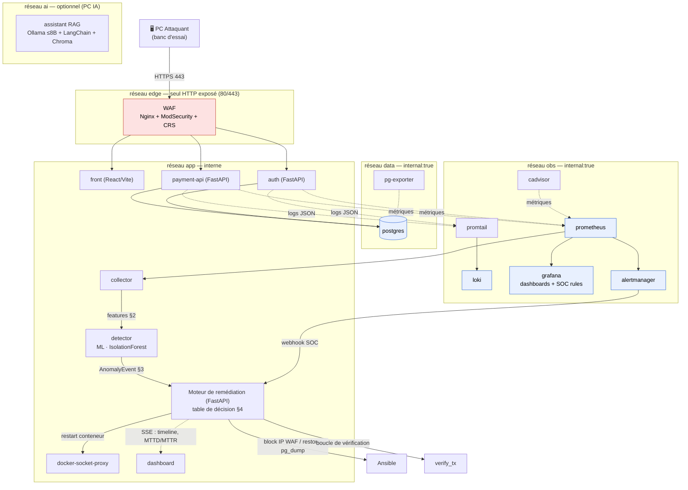

# Architecture — PROJECT RESILIENCE-ALPHA

> Vue d'ensemble technique. Les interfaces détaillées sont dans [`contracts.md`](contracts.md) ; le cadrage dans [`../CAHIER-DES-CHARGES.md`](../CAHIER-DES-CHARGES.md).

## Vue logique

## Composants et responsabilités

| Composant | Techno | Réseau | Exposé | Rôle |
|---|---|---|---|---|
| waf | Nginx+ModSecurity+CRS | edge, app | **oui (80/443)** | Filtrage applicatif, unique point d'entrée HTTP, blocage IP |
| front | React/Vite/TS/Tailwind | app | via WAF | Interface de paiement utilisateur |
| payment-api | FastAPI | app | via WAF | Comptes, transactions fictives |
| auth | FastAPI | app | via WAF | Login/register, JWT, rate-limit |
| postgres | PostgreSQL 16 | data | non | Persistance (comptes, transactions) |
| prometheus | Prometheus | obs | non | Métriques |
| loki + promtail | Loki | obs | non | Logs centralisés (fonction SOC) |
| grafana | Grafana | obs | non | Dashboards + règles d'alerte SOC |
| alertmanager | Alertmanager | obs | non | Routage d'alertes → remédiation |
| cadvisor | cAdvisor | obs | non | CPU/RAM par conteneur |
| waf-exporter | Python (`security/waf/waf_exporter.py`) | obs | non | Audit ModSecurity → `resilience_waf_blocked_total{rule}` (:9188) |
| collector | Python | app | non | Construit le vecteur de features (15 s) |
| detector | FastAPI + scikit-learn | app | non | Score ML, émet l'AnomalyEvent |
| remediation | FastAPI + ansible-runner | app | non | Décision + actions + vérification |
| docker-socket-proxy | HAProxy (liste blanche stricte) | app | non | Médie l'accès Docker (verbes limités) |
| mosquitto | MQTT | app | `192.168.137.1:1883` (`iot`) | Transporte les états LED de `auth` vers l'ESP8266 |
| dashboard | React/Vite/TS/Tailwind | app/obs | via WAF/interne | Supervision, timeline, MTTD/MTTR |
| assistant | FastAPI + LangChain + Ollama | ai | non | RAG opérateur (lecture seule) |

## Flux de la reprise autonome (chemin critique de la démo)

Pour l'IoT, le navigateur du back-office appelle `auth` via le WAF ; `auth` publie ensuite
un état sur Mosquitto via le réseau Docker `app`. L'ESP8266, connecté au PA, s'abonne
au broker sur `192.168.137.1:1883`. Le WAF traite HTTP/HTTPS ; le
`docker-socket-proxy` ne sert qu'aux actions Docker de la remédiation. Le client MQTT
dans `auth` reste à raccorder (lot L5-2).

1. **avant** — `verify_tx` → transaction fictive OK (exit 0).
2. **attaque** — scénario lancé depuis le PC Attaquant vers le WAF.
3. **détection** — collector agrège les métriques → detector score via IsolationForest → dépassement de seuil → `AnomalyEvent` (type d'incident classé) envoyé (authentifié) au moteur.
4. **remédiation** — le moteur sélectionne les actions dans `decision_table.yml`, les exécute (restart via proxy / block IP via Ansible / restore dump), en respectant cooldown/max_attempts/dry_run.
5. **après** — boucle de vérification : `verify_tx` OK → incident clos, MTTD/MTTR calculés, timeline poussée au dashboard. **Sans intervention humaine.**

## Choix structurants (ADR)

Voir [`adr/`](adr/). Résumé : mono-langage Python/FastAPI, SOC = règles Loki/Grafana, remédiation via docker-socket-proxy (jamais le socket brut), attaque depuis PC physique pour la démo notée, Ollama déportable sur PC IA.

## Contraintes de ressources (16 Go)

Profil Compose `demo` = chemin critique minimal (WAF, waf-exporter, front, payment-api, auth, postgres, prometheus, loki, promtail, grafana, collector, detector, remediation, dashboard). Observabilité complète (`alertmanager`, `cadvisor`, `pg-exporter`) et `ai` (Ollama) en profils additionnels, l'IA de préférence sur le PC IA.
